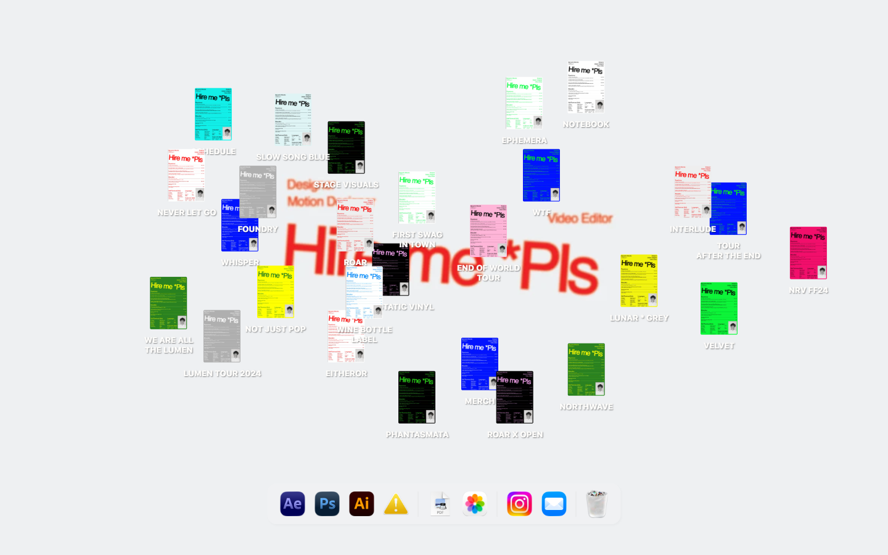
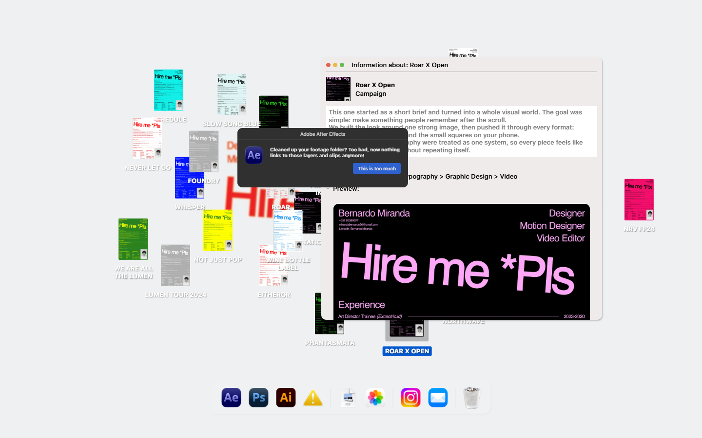
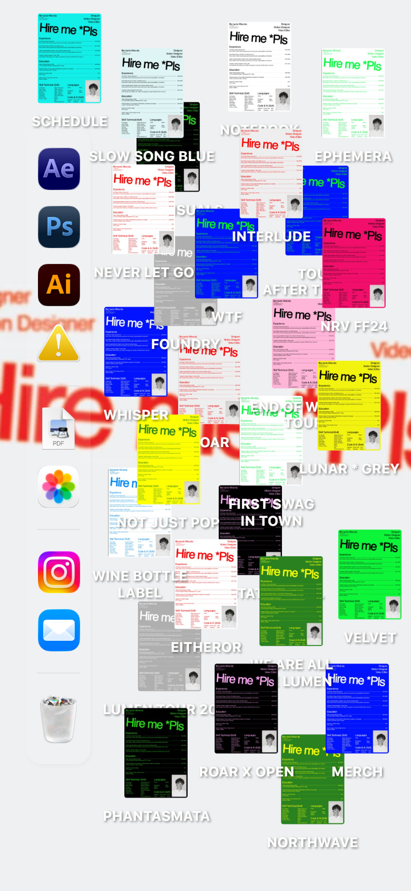

# Bernardo Miranda: desktop portfolio

A one-screen "desktop" portfolio: draggable project icons over a full-screen background, a dock, Finder-style project windows, joke alert dialogs and the CV as a PDF.







## Run it

```
npm install
npm run build
npm start
```

Then open http://localhost:3200.

## How it works

- `app/` — layout (Inter via `next/font`), page, `globals.css` (sizes, colours, animations)
- `components/Desktop.tsx` — icons, drag, open windows, alerts
- `components/Window.tsx` — project, gallery, bin and PDF windows
- `components/Dock.tsx`, `Alert.tsx`, `AppIcons.tsx` — dock, alerts, app icons
- `lib/content.ts` — projects, copy, alerts, the CV PDF; `lib/layout.json` — icon positions per screen size
- `public/` — background (`bg-hireme.webp`), CV images (`projects/`), dock icons (`apps/`), CV (`cv_miranda_final.pdf`)

## Behaviour

- Hover an icon: grey box, larger picture, blue label (195 ms). Drag to move it; click to open its window.
- Windows and alerts drag from anywhere; red dot closes a window (210 ms animation).
- Dock: After Effects / Photoshop / Illustrator / Error open alerts; CV opens the PDF; Photos opens the gallery; Bin opens "Bin of ideas"; Instagram and Mail are links.
- Breakpoints: ≤ 1199 px tablet layout with a side dock; ≤ 809 px mobile layout.
